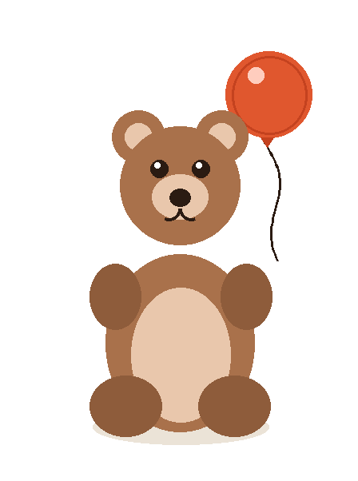
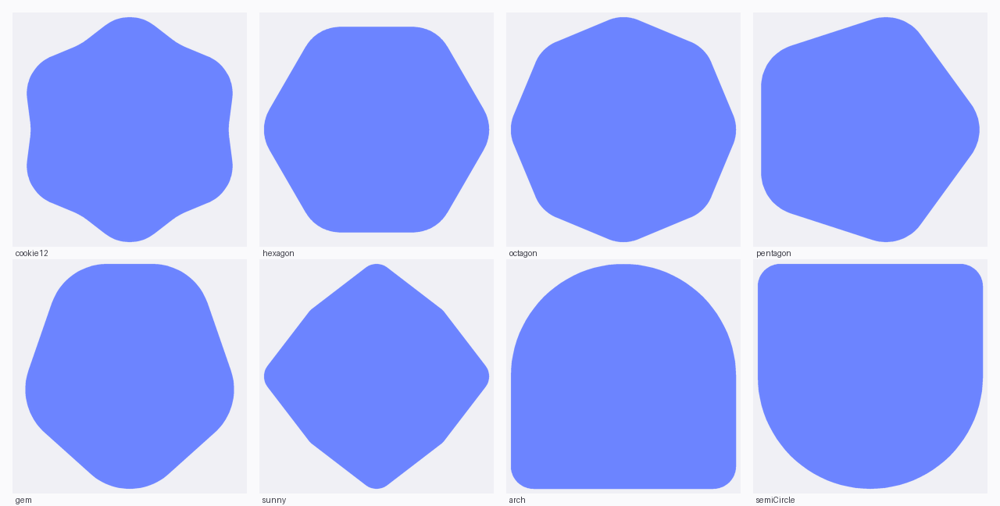
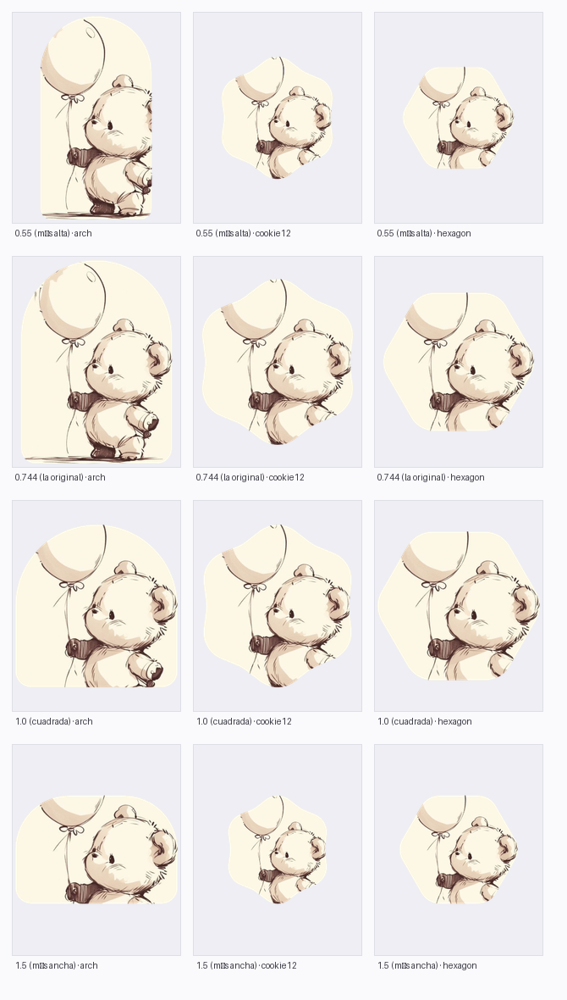
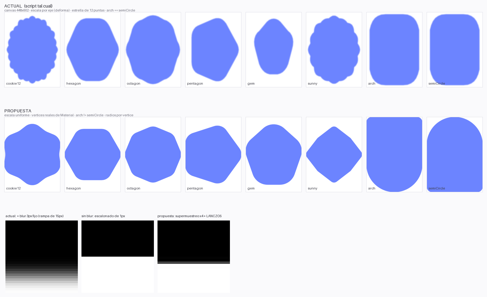

# kitty-shapes

Emblemas con formas de **Material 3** a partir de cualquier imagen, en
TypeScript, para correr con **Bun**.

La idea: una ilustración (o tu avatar) se recorta con formas distintas —cookie,
hexágono, arco, semicírculo…— y el shell **rota** entre ellas en cada arranque
(nunca repite la anterior). Siempre la misma imagen, silueta distinta.

```
install.sh        # instalador: deps, binario, configs y enganche de fish
src/
├── geometry.ts   # geometría pura: polígonos, estrellas, fillets (sin canvas)
├── shapes.ts     # las recetas de Material 3
├── detect.ts     # detecta la lámina y el sujeto solos
├── render.ts     # dibuja con Canvas2D y recorta por la forma
├── quantize.ts   # cuantización de color (PNG más ligero)
└── cli.ts        # la línea de órdenes
docs/
├── ARQUITECTURA.md  # qué hace cada archivo y cada función del script
├── FLUJO.md         # los flujos: arranque, render, re-render, cache, watcher
├── RENDIMIENTO.md   # medidas, metodología y qué se optimizó
├── BUGS.md          # errores encontrados, causa raíz y fix
├── PRUEBAS.md       # cómo se prueba (arnés pty, fuzz, carrera)
└── NOCTALIA.md      # conectar con Noctalia v5 y con el login screen
tests/
├── geometry.test.ts   # geometría, formas y máscara
├── detect.test.ts     # lámina/sujeto (incluye alfa)
└── quantize.test.ts   # paleta, color medio y alfa
examples/
├── fastfetch-kitty.sh      # el script de fastfetch, listo para copiar
├── fastfetch-config.jsonc  # la config de fastfetch, lista para copiar
├── fastfetch-config-min.jsonc # versión corta para ventanas medianas
├── fastfetch-config-micro.jsonc # versión mínima (2 líneas) para ventanas chicas
├── emblem-shapes.txt       # las formas que pueden salir
└── noctalia-avatar-check.sh  # diagnóstico del avatar
```

## Documentación

| Documento | Qué cubre |
|---|---|
| [`docs/ARQUITECTURA.md`](docs/ARQUITECTURA.md) | El mapa: qué hace cada archivo del repo y cada función del script, en qué orden corre todo |
| [`docs/FLUJO.md`](docs/FLUJO.md) | Los seis flujos: arranque en frío, en caliente, prefetch, layout, render y re-render |
| [`docs/RENDIMIENTO.md`](docs/RENDIMIENTO.md) | Cuánto tarda cada fase, cómo se midió y qué quedó por optimizar |
| [`docs/BUGS.md`](docs/BUGS.md) | Los errores que aparecieron (protocolo, procesos, concurrencia) y su causa raíz |
| [`docs/PRUEBAS.md`](docs/PRUEBAS.md) | El arnés de pty y las pruebas de fuzz, carrera, cache y re-render |
| [`docs/NOCTALIA.md`](docs/NOCTALIA.md) | Cómo conectar con Noctalia v5 y con el login screen (SDDM) |
| [`examples/fastfetch-kitty.sh`](examples/fastfetch-kitty.sh) | El script de fastfetch, listo para copiar |
| [`examples/fastfetch-config.jsonc`](examples/fastfetch-config.jsonc) | La config de fastfetch (bloque `logo` + dossier), lista para copiar |
| [`examples/emblem-shapes.txt`](examples/emblem-shapes.txt) | La lista de formas, editable |
| [`examples/noctalia-avatar-check.sh`](examples/noctalia-avatar-check.sh) | Diagnóstico del avatar (bash: guárdalo como fichero y ejecútalo) |

## Instalación

**Requisito**: `bun` **1.4 o superior**. Con bun 1.3 el `bun.lock` (formato v2)
no se puede leer y se reescribe en cada instalación.

### Todo de una (instalador)

```bash
./install.sh            # instala y deja el greeting andando
./install.sh --dry-run  # muestra qué haría, sin tocar nada
./install.sh --uninstall
```

Qué hace, en orden:

| # | Paso | Resultado |
|---|---|---|
| 1 | comprueba `bun`, `fastfetch`, `kitty` | avisa cómo instalar lo que falte |
| 2 | `bun install` + `typecheck` + `test` | 17 tests en verde |
| 3 | compila el binario | `~/.config/fastfetch/kitty-shapes` |
| 4 | copia el script del greeting | `~/.config/fastfetch/b3l0wz3r0-fastfetch` |
| 5 | copia las 3 configs y la lista de formas | `~/.config/fastfetch/` |
| 6 | engancha `fish_greeting` | `~/.config/fish/config.fish` |
| 7 | verifica | el binario responde, el script es bash válido |

**Nunca pisa tu configuración.** Las configs (`config*.jsonc`) y la lista de
formas se crean solo si no existen: tus colores los sincroniza Noctalia y el
instalador no los toca. Si la versión del repo difiere, te lo dice y te deja
decidir. El script y el binario sí se actualizan, con backup automático
(`<archivo>.bak-<fecha>`).

Es idempotente: podés ejecutarlo las veces que quieras.

### A mano

```bash
bun install
bun build --compile ./src/cli.ts --outfile ~/.local/bin/kitty-shapes
```

Única dependencia: `@napi-rs/canvas` (binarios precompilados, sin compilación).
Para actualizar bun: `bun upgrade`.

## Uso

```bash
# una forma al azar por stdout (para pintar en Kitty)
kitty-shapes pick osito.png | kitty +kitten icat

# una forma concreta
kitty-shapes pick osito.png --shape arch --path --out avatar.png

# las 8 de golpe, con un manifest
kitty-shapes build osito.png --out osito-shapes
kitty-shapes pick osito-shapes/manifest.json | kitty +kitten icat

# con un manifest también podés fijar la forma (y usar --path / --escape)
kitty-shapes pick osito-shapes/manifest.json --shape arch --path

# todos los flags
kitty-shapes --help
```

El arranque es rápido: Skia se carga **solo cuando hay que dibujar**, así que
`--help` y `list` responden en ~16 ms y el crop completo en ~135 ms.

Y si prefieres no depender del binario `kitten`:

```bash
kitty-shapes pick osito.png --escape   # escribe la secuencia del protocolo gráfico
```

## Demo









## Desarrollo

```bash
bun test             # 17 tests: geometría, detección, cuantización
bun run typecheck    # tsc --noEmit (incluye tests/)
```

### En el shell de Kitty

```fish
function kitty_bear
    kitty-shapes pick ~/osito.png | kitty +kitten icat
end
```

## Con fastfetch (el caso de uso)

El flujo es: **el emblema se corta una vez y se cachea** → el shell se lo pasa a
fastfetch → fastfetch lo pinta con el protocolo gráfico de Kitty. Cuando la terminal cambia
de ancho, un watcher redibuja el bloque con el layout correcto.

```
kitty-shapes pick  →  cache (140 ms, una vez)  →  fastfetch  →  kitty
                              ↑
                    prefetch en background:
                    la forma de la próxima terminal
```

El corte **no** se hace en cada apertura: cuesta ~140 ms y sería el 77 % del
arranque. La primera terminal lo genera, las siguientes lo reutilizan (~2 ms) y
en segundo plano se prepara una forma nueva para la próxima — así cada terminal
sigue mostrando una silueta distinta sin pagar el costo.

El greeting se adapta al tamaño: imagen al lado del texto completo, imagen
arriba, imagen al lado del texto compacto, solo texto, o nada. Elige la mejor
que entre en cada ventana. Y solo se redibuja durante los primeros segundos
(`FASTFETCH_RERENDER_GRACE`, 15 por defecto): después se apaga y no toca más la
pantalla.

El recorrido completo está en [`docs/FLUJO.md`](docs/FLUJO.md) y los números en
[`docs/RENDIMIENTO.md`](docs/RENDIMIENTO.md).

### Instalación completa

```bash
# 1. Dependencias del repo
bun install

# 2. El binario: sin runtime, sin transpilación en cada arranque
bun build --compile ./src/cli.ts --outfile ~/.config/fastfetch/kitty-shapes

# 3. La lista de formas (editable: una forma por línea)
cp examples/emblem-shapes.txt ~/.config/fastfetch/emblem-shapes.txt

# 4. El script y la config de fastfetch
cp examples/fastfetch-kitty.sh   ~/.config/fastfetch/b3l0wz3r0-fastfetch
chmod +x ~/.config/fastfetch/b3l0wz3r0-fastfetch
cp examples/fastfetch-config.jsonc ~/.config/fastfetch/config.jsonc

# 5. La carpeta del emblema estable (el "source" del config)
mkdir -p ~/.config/fastfetch/emblem
```

Después, el script se invoca desde el módulo de saludo de fish (o de lo que sea):

```fish
function fish_greeting
    ~/.config/fastfetch/b3l0wz3r0-fastfetch
end
```

### El render: cache + prefetch

La rama de kitty del script resuelve el emblema así (resumido):

```bash
# ¿el cache sigue válido para esta fuente?
if [ -s "$cached_emblem" ] && [ "$stamp_cache" = "$stamp_now" ]; then
  cp -f "$cached_emblem" "$emblem" && used_cache=1
fi

# si no, se corta una forma al azar y se guarda (tmp + mv atómico)
if [ "$used_cache" = "0" ]; then
  "$shapes_bin" pick "$source_img" --size 384 --palette 256 \
    "${shape_args[@]}" --path --out "$emblem"
fi
```

Y al final, si esta terminal usó el cache, se prepara la forma de la próxima en
background:

```bash
[ "$used_cache" = "1" ] && prefetch_emblem &
```

La **huella** (`stamp`) incluye el mtime y tamaño del avatar, el mtime de la
lista de formas, el mtime del state de Noctalia y el tamaño/paleta. Si cambiás
el avatar, el cache se invalida solo.

Y el `config.jsonc` de fastfetch, con el logo apuntando al emblema:

```jsonc
{
  "logo": { "type": "kitty-direct", "source": "~/.config/fastfetch/emblem/current.png" }
}
```

El `config.jsonc` completo y comentado está en
[`examples/fastfetch-config.jsonc`](examples/fastfetch-config.jsonc) — es un
ejemplo funcional, se copia tal cual a `~/.config/fastfetch/config.jsonc`.

Lo único que necesita kitty-shapes del config es el bloque **`logo`**:

| Campo | Qué hace |
|---|---|
| `type: "kitty-direct"` | transmite el PNG por el protocolo gráfico de Kitty (sin chafa) |
| `source` | path **estable** del último emblema renderizado con éxito |
| `width` | ancho del logo en celdas (el script lo lee para calcular el layout) |

> El `source` apunta a `emblem/current.png` y **no** al fichero temporal: así
> fastfetch siempre tiene un logo válido aunque el script no llegue a pasar
> `--logo`.

Detalles que importan:

- **Un fichero por proceso**: `$XDG_RUNTIME_DIR/fastfetch-emblem-<pid>.png`.
  No se puede usar `KITTY_WINDOW_ID` porque **vale 1 en todas las instancias**
  recién abiertas y dos terminales escribirían el mismo PNG.
- **El watcher es el dueño**: al arrancar copia el emblema a un archivo con su
  propio PID. Con el del script padre (que muere enseguida), el barrido de la
  próxima terminal lo borraría y esa terminal perdería el logo en el resize.
- **El cache** vive en `$XDG_RUNTIME_DIR/fastfetch-cache/` (`emblem.png` +
  `stamp`) y se escribe con `tmp` + `mv`, igual que `emblem/current.png`.
- A fastfetch le sirve con **384 px** de lado largo (el logo se pinta a ~30
  celdas de alto). Con `--palette 256` cada PNG pesa ~55-80 KB según la forma.
- El alfa se respeta: fastfetch transmite el PNG con transparencia ✓.
- Si no hay emblema (ni cache ni kitty-shapes), el script pide
  `--logo-type none`: **nunca** deja que fastfetch caiga al logo ASCII del
  sistema por un PNG corrupto.

### La fuente es el avatar de Noctalia

El script puede leer de Noctalia cuál es tu avatar y usarlo **como imagen de
origen**, así que no hay dos sitios que mantener: cambias el avatar y los
emblemas cambian solos.

```bash
# qué avatar tiene Noctalia ahora mismo (2 formas, según de dónde salga)
sed -n 's/^[[:space:]]*avatar_path[[:space:]]*=[[:space:]]*"\(.*\)".*/\1/p' \
  ~/.local/state/noctalia/settings.toml          # 1 ms
noctalia config export | grep avatar_path        # 24 ms (respaldo)
```

En el script de fastfetch:

```bash
# 1) el state que escribe la GUI (rápido)
noctalia_state="${XDG_STATE_HOME:-$HOME/.local/state}/noctalia/settings.toml"
[ -f "$noctalia_state" ] && source_img="$(sed -n 's/…/\1/p' "$noctalia_state" | head -1)"

# 2) si no hay, la config exportada (lento pero canónico)
[ -z "$source_img" ] && command -v noctalia >/dev/null 2>&1 && \
  source_img="$(noctalia config export 2>/dev/null | sed -n 's/…/\1/p' | head -1)"

source_img="${source_img/#\~/$HOME}"
[ -f "$source_img" ] || source_img="$fallback_img"
```

> **Por qué el `settings.toml` y no el `config.toml`.** En
> `~/.config/noctalia/config.toml` el `avatar_path` suele estar **vacío** (es el
> default). El valor real lo escribe la GUI en
> `~/.local/state/noctalia/settings.toml`. Leer el `config.toml` te deja sin
> avatar.
>
> **Ojo con el doble recorte.** Si el `avatar_path` apunta a un emblema ya
> recortado, el fastfetch lo recorta otra vez y el oso sale con los bordes
> comidos. Apunta el avatar al **dibujo original** y así cada terminal enseña
> un corte distinto del mismo dibujo.

### Las formas, en un fichero de texto

Para añadir o quitar una figura **no hay que tocar código**: se edita un
fichero con una forma por línea.

```
# ~/.config/fastfetch/emblem-shapes.txt
# Las líneas vacías y las que empiezan por # se ignoran.
cookie12
hexagon
octagon
pentagon
gem
sunny
arch
semiCircle
```

```bash
kitty-shapes pick osito.png --shapes-file ~/.config/fastfetch/emblem-shapes.txt
```

Si el fichero no existe, se usan las 8 por defecto. Si una forma está mal
escrita, el tool lo dice y sale con error en vez de fallar en silencio:

```
error: formas desconocidas en emblem-shapes.txt: triangulo
```

Las formas disponibles están todas en `src/shapes.ts` (hay más de las ocho:
`cookie4`, `cookie6`, `cookie7` y `cookie9` también).

### Coste real (medido)

**Del corte** (kitty-shapes, proceso nuevo):

| | tiempo | notas |
|---|---|---|
| En vivo (`--size 384 --palette 256`) | **~145 ms** | ~77 KB, 288×384 RGBA |
| En vivo (`--size 256 --palette 128`) | ~140 ms | ~55 KB — bajar el tamaño **casi no ahorra** |
| Desde el manifest (pre-generado) | ~145 ms | solo lee el fichero |

> Ojo con la causa: **~90 ms son importar `@napi-rs/canvas`** (el binding nativo),
> no el trabajo. Detectar + render + cuantizar + codificar son ~52 ms. Por eso el
> greeting cachea el emblema.

**Del greeting completo** (script + fastfetch), medido en un pty:

| | tiempo | notas |
|---|---:|---|
| Primera terminal (frío, sin caché) | **~177 ms** | incluye el corte (~145 ms) |
| Terminales siguientes (caché) | **~18 ms** | `cp` del caché + fastfetch (sin DSR) |
| Fuera de kitty | ~10 ms | se salta todo el bloque del emblema |

El detalle fase por fase y la metodología están en
[`docs/RENDIMIENTO.md`](docs/RENDIMIENTO.md).

## Tamaño: se adapta a la imagen

El lienzo conserva **siempre** el aspecto de la imagen, así que las formas
nunca se deforman. Las formas verticales (`arch`, `semiCircle`) se construyen
con ese mismo aspecto, y por eso el oso entero cabe dentro de ellas.

| Opción | Qué hace |
|---|---|
| `--size 1100` | el lado largo del resultado (por defecto: el de la imagen, hasta 1100) |
| `--size source` | exactamente la resolución original |
| `--width 400` | ancho explícito (el alto sale del aspecto) |
| `--aspect 0.6` | **fuerza la proporción** del lienzo (`0.6` o `16/9`) |
| `--square` | lienzo cuadrado, recortando la imagen |

### Forzar el aspecto: más alta o más ancha

Por defecto el lienzo hereda la proporción de la imagen. Con `--aspect` la
fuerzas, y lo que cambia es **el encuadre**, no el tamaño (el lado largo se
mantiene):

```bash
kitty-shapes pick osito.png --aspect 0.55   # más alta (0,55 = 1:1,8)
kitty-shapes pick osito.png --aspect 16/9   # más ancha
kitty-shapes pick osito.png --square        # cuadrada
```

El arte se recorta para cubrir la forma, así que al cambiar la proporción
cambia **cuánto** se recorta y **qué** se conserva. El `--focus` decide qué
parte sobrevive (p. ej. `--focus 0.5,0.35` sube el encuadre para que no se
pierda la cabeza):

```bash
kitty-shapes pick osito.png --aspect 1.5 --focus 0.5,0.35
```

Un par de reglas prácticas:

- **Formas verticales** (`arch`, `semiCircle`) se construyen con el aspecto
  del lienzo, así que un lienzo alto las llena y el oso entero cabe dentro.
- **Formas redondas** (`cookie12`, `hexagon`, `sunny`) se inscriben en el
  lienzo: en un lienzo alto quedan con bandas transparentes arriba y abajo, y
  en uno ancho se comen la parte de arriba y abajo del dibujo. Si vas a
  forzar un aspecto raro, usa las verticales.

## Recorte y sujeto automáticos

`detect.ts` saca el color de fondo de las esquinas, calcula la tinta (todo lo
que se aleja de ese color) y separa:

- **la lámina**: el dibujo completo.
- **el sujeto**: la caja del oso y el globo, sin la línea de suelo (que se
  detecta porque toca el borde izquierdo).

Si la imagen tiene canal alfa, se usa directamente, así que funciona igual con
un dibujo a tinta sobre papel que con una ilustración con fondo transparente.

## Opciones

| Opción | Qué hace |
|---|---|
| `--out <dir>` | carpeta de salida |
| `--size <px\|source>` | tamaño del lienzo |
| `--width <px>` | ancho explícito |
| `--aspect <w/h>` | fuerza la proporción del lienzo (`0.6`, `16/9`) |
| `--square` | lienzo cuadrado |
| `--shapes a,b,c` | qué formas usar |
| `--shapes-file <ruta>` | fichero con las formas, una por línea (`#` = comentario) |
| `--shape <n\|random>` | una forma concreta o al azar (en `pick`) |
| `--inset 0.02` | margen de la forma respecto al lienzo |
| `--focus 0.5,0.4` | punto focal del arte (0..1) |
| `--protect` | el sujeto no se corta nunca (recoloca o encoge el arte) |
| `--palette 256` | cuantiza el PNG a N colores (baja el peso ~2-6×); `0` = sin cuantizar |
| `--path` | en `pick`, escribe el PNG a un fichero y printa la ruta |
| `--escape` | en `pick`, printa la secuencia del protocolo gráfico de Kitty |
| `--list` | lista las formas |

## La forma manda

El recorte es `arte ∩ forma`, igual que en AndroidX: la silueta del emblema es
la forma y el arte se recorta contra ella. Con `--protect` el arte se recoloca
(o se encoge) hasta que la caja del sujeto queda **entera** dentro de la forma.

## Tests

```bash
bun test
```

17 tests: la semántica de vértices de Material, la tangencia del arco, los
vértices cóncavos, que la escala sea uniforme, que `arch` ≠ `semiCircle`, y
que la máscara de la forma no tenga agujeros (un bug real: el `%` de
JavaScript sale negativo y los arcos giraban al revés).

## Notas de fidelidad a Material

- **Semántica de las estrellas.** La API actual `RoundedPolygon.star(numVerticesPerRadius)`
  cuenta vértices *por radio*; el port antiguo `Shapes.star(pointCount, …)` que
  usa m3shapes contaba vértices *totales*. Las recetas de m3shapes
  (`cookie12Sided = rotated(star(12, 1.0, 0.8, round 50), -90)`,
  `sunny = star(8, 1.0, 0.8, round 15)`) están en la semántica antigua y aquí
  se traducen: 12 vértices = 6 puntas, 8 vértices = 4 puntas.
- **Redondeo.** El radio es el del *arco* (`t = r / tan(θ/2)`, centro a
  `r / sin(θ/2)`), como `CornerRounding` de Material, y se puede dar por
  vértice (`perVertexRounding`).
- **Límite conocido.** El `smoothing` de Material (la esquina en tres curvas
  que da el aspecto globoso de las cookies) no está implementado: aquí el
  redondeo es el arco tangente puro (`smoothing = 0`).
